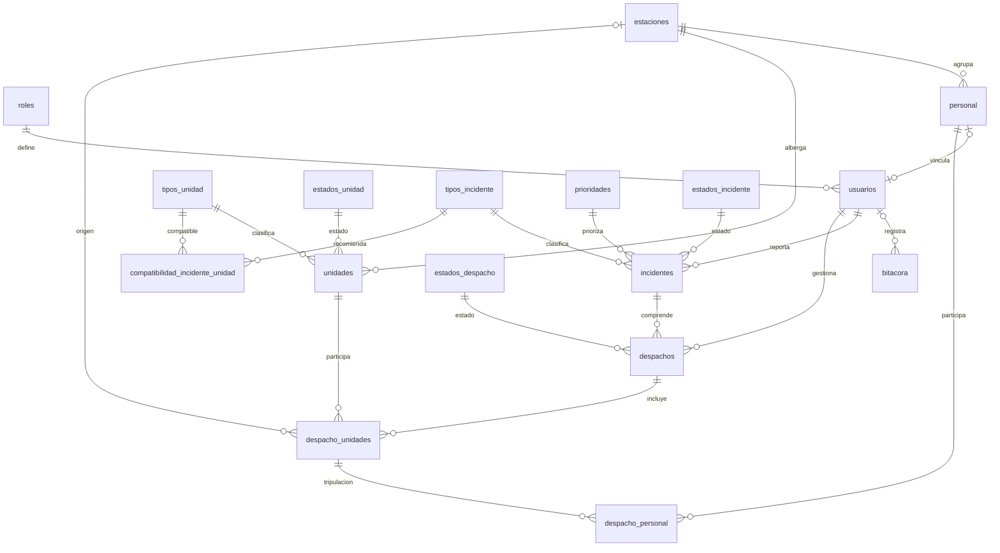

[README.md](https://github.com/user-attachments/files/33778844/README.md)
# 🚒 FireCommand

**Sistema de gestión administrativa y operativa bomberil** · Python · CustomTkinter · MySQL · MVC

[Repositorio en GitHub](https://github.com/silk-reza/Fire-Command)

FireCommand es una aplicación de escritorio desarrollada para organizar la información de **estaciones de bomberos, personal y unidades de respuesta**, y apoyar el registro de **incidentes, despachos y asignaciones operativas**. Su modelo de datos permite seguir el ciclo de una emergencia desde el reporte hasta su cierre, relacionando las unidades y el personal participante.

> **Proyecto académico (Programación II, UMG) en desarrollo.** El diseño documentado en `schema.sql` y los escenarios de `seed.sql` no implican que todas las pantallas, validaciones y operaciones ya estén implementadas en Python. **No está destinado a coordinar emergencias reales** sin pruebas y validación adicionales.

## ✨ Alcance funcional

| Área | Alcance definido en la base de datos |
| --- | --- |
| Acceso y roles | Roles de administrador, operador y consulta; usuarios activos/inactivos y contraseñas con hash. |
| Estaciones y personal | Estaciones, ubicación, contactos, cargos y asignación del personal a cada estación. |
| Unidades de respuesta | Tipos, capacidad, estación de pertenencia, condición administrativa y estado operativo. |
| Incidentes | Clasificación, prioridad, ubicación, personas afectadas y fechas de seguimiento. |
| Despachos | Creación, activación, finalización o cancelación vinculadas a incidentes. |
| Participaciones y tripulaciones | Unidades asignadas por despacho, estación de origen y personal participante. |
| Compatibilidad | Preferencias de tipos de unidad por tipo de incidente, ordenadas por prioridad de recomendación. |
| Auditoría | Bitácora con usuario, acción, entidad, detalle y fecha/hora. |

Estas capacidades están **modeladas**; su disponibilidad real en la interfaz depende del avance de cada módulo.

## 📍 Estado de implementación

| Componente | Estado actual |
| --- | --- |
| Esquema MySQL (17 tablas) | ✅ Probado en MySQL |
| Dataset de demostración | ✅ Cargado y probado |
| Integridad de base de datos | ✅ Probada |
| Conexión Python ↔ MySQL | ✅ Probada |
| Autenticación | 🚧 En desarrollo |
| Administración de usuarios | ⏳ Pendiente |
| Estaciones y personal | ⏳ Pendiente |
| Gestión de unidades e incidentes | ⏳ Pendiente |
| Despachos y asignación operativa | ⏳ Pendiente |
| Dashboard y reportería | ⏳ Pendiente |

> Este estado se actualizará conforme cada módulo complete sus casos válidos, casos inválidos y pruebas correspondientes.

## 🔁 Flujo operativo previsto

```text
Reporte de incidente
        ↓
Registro y clasificación
        ↓
Creación del despacho (borrador)
        ↓
Preselección de unidades y personal
        ↓
Activación y asignación de recursos
        ↓
Salida → Llegada a escena
        ↓
Atención → Control del incidente
        ↓
Liberación y retorno de recursos
        ↓
Finalización de despachos → Cierre del incidente
```

Este flujo describe la **operación objetivo**. Los incidentes o despachos también pueden cancelarse cuando corresponda.

## 🛠️ Tecnologías y arquitectura

- **Python 3.x:** lenguaje principal; la versión exacta usada para la entrega se documentará una vez quede fijado el entorno final.
- **CustomTkinter:** interfaz gráfica de escritorio.
- **MySQL 8.0.16+ / InnoDB:** almacenamiento relacional con claves foráneas y restricciones `CHECK`. La base se ha probado actualmente con **MySQL 8.4.11**.
- **MVC (Modelo–Vista–Controlador):** arquitectura del proyecto.
- **`.env`:** configuración externa de conexión, sin publicar credenciales privadas.

La aplicación está organizada bajo **MVC**, con responsabilidades diferenciadas:

```text
Vista (CustomTkinter)
        ↓
Controlador (orquestación y validación del flujo)
        ↓
Modelo (consultas, persistencia y reglas de datos)
        ↓
MySQL
```

No se requiere una capa adicional de `services`: los controladores coordinan el flujo, los modelos realizan acceso a datos y las vistas no contienen SQL.

### Estructura general

```text
Fire-Command/
├── config/          # Configuración de aplicación y base de datos
├── controllers/     # Coordinación de flujos
├── database/        # schema.sql, seed.sql y recursos SQL (ruta recomendada)
├── docs/            # Documentación
├── models/          # Modelos y persistencia
├── tests/           # Pruebas
├── utils/           # Utilidades compartidas
├── views/           # Pantallas de CustomTkinter
├── .env.example     # Variables de entorno de ejemplo
├── main.py          # Punto de entrada
└── README.md
```

> El árbol resume la estructura actual prevista para el proyecto. `main.py` es el punto de entrada; los flujos de inicio de sesión, navegación y cierre de sesión se completarán conforme avance la implementación.

## 🗄️ Base de datos MySQL

`schema.sql` crea la base **`firecommand`** con `utf8mb4`, colación `utf8mb4_0900_ai_ci` y **17 tablas**.

| Área | Tablas |
| --- | --- |
| Identidad y auditoría | `roles`, `usuarios`, `bitacora` |
| Organización | `estaciones`, `personal` |
| Recursos | `tipos_unidad`, `estados_unidad`, `unidades` |
| Incidentes | `tipos_incidente`, `prioridades`, `estados_incidente`, `incidentes` |
| Despachos | `estados_despacho`, `despachos`, `despacho_unidades`, `despacho_personal` |
| Recomendaciones | `compatibilidad_incidente_unidad` |

### Relaciones principales



*Diagrama simplificado; las cardinalidades reflejan las claves foráneas y la opcionalidad relevante, no las reglas completas del dominio.*

### Máquinas de estado

Las siguientes máquinas forman parte del **diseño funcional de FireCommand v1.0**. Los estados internos se cargan mediante `seed.sql`; MySQL protege invariantes locales con restricciones, mientras que las transiciones y precondiciones operativas corresponden a la lógica Python.

**Incidente:**

```text
REPORTADO → ASIGNADO → EN_ATENCION → CONTROLADO → CERRADO
      └────────────── cancelación según el caso ─────────→ CANCELADO
```

**Despacho:**

```text
CREADO → ACTIVO → COMPLETADO
   └───────────────→ CANCELADO (según el caso)
```

**Unidad:**

```text
DISPONIBLE → DESPACHADA → EN_RUTA → EN_ESCENA → REGRESANDO → DISPONIBLE
```

Existen además los estados de unidad **`MANTENIMIENTO`** y **`FUERA_DE_SERVICIO`**. El campo `activo` se utiliza de forma independiente al estado operativo: una unidad activa puede encontrarse fuera de servicio.

### Integridad y concurrencia

El esquema incorpora claves primarias y foráneas, restricciones `UNIQUE`, `NOT NULL` y `CHECK`, controles sobre pares de coordenadas, y verificaciones de cronología de incidentes, despachos y participaciones. Las eliminaciones están restringidas en la mayoría de relaciones; algunas referencias opcionales usan `ON DELETE SET NULL`.

**Diseño previsto de concurrencia:** para evitar doble asignación o conflictos simultáneos, las operaciones críticas de activación de despachos y compromiso de unidades/personal utilizarán **transacciones**, revalidación de disponibilidad y, cuando corresponda, **`SELECT ... FOR UPDATE`**, confirmando con `COMMIT` o revirtiendo con `ROLLBACK`. Esta lógica se validará al implementar los flujos operativos en Python.

## 🧪 Dataset de demostración (`seed.sql`)

El dataset se diseñó para representar situaciones operativas variadas, con registros activos, inactivos e históricos:

| Entidad | Registros preparados |
| --- | ---: |
| Roles | 3 |
| Estaciones | 3 |
| Personal | 15 |
| Usuarios | 5 |
| Tipos de unidad | 6 |
| Estados de unidad | 7 |
| Unidades | 11 |
| Tipos de incidente | 6 |
| Prioridades | 4 |
| Estados de incidente | 6 |
| Estados de despacho | 4 |
| Compatibilidades incidente/unidad | 21 |
| Incidentes | 8 |
| Despachos | 9 |
| Participaciones de unidades | 12 |
| Integrantes de tripulaciones | 22 |
| Registros de bitácora | 18 |

Incluye incidentes **reportados, asignados, en atención, controlados, cerrados y cancelados**; despachos **creados, activos, completados y cancelados**; unidades con todos los estados contemplados; preselecciones sin activar, participaciones canceladas y ejemplos de auditoría.

**Importante:** `seed.sql` se ejecuta **una sola vez sobre un esquema limpio**. Utiliza identificadores y códigos únicos; no incluye `INSERT IGNORE` ni `ON DUPLICATE KEY UPDATE`, por lo que repetir su ejecución puede provocar errores de duplicación. Los valores son ficticios y exclusivos de demostración.

### Cuentas demo

El script contiene las cuentas `admin.demo`, `operador.central`, `operador.norte`, `consulta.sur` y `operador.inactivo` (esta última está deshabilitada para probar rechazo de acceso). Las contraseñas se almacenan como **hash bcrypt**. La contraseña compartida está documentada en el encabezado de `database/seed.sql` —si el archivo se incorpora en esa ruta—; **no reutilices estas credenciales fuera de un entorno de demostración**.

## 🔐 Seguridad

FireCommand separa la seguridad de infraestructura de la lógica todavía en implementación.

**Ya configurado/probado:**

- `.env` local fuera del repositorio y `.env.example` como plantilla.
- Usuario MySQL dedicado `firecommand_app`, separado de `root`.
- Hashes **bcrypt** en las cuentas demo; no se almacenan contraseñas en texto plano en `usuarios`.
- Restricciones de integridad en MySQL y dataset de prueba controlado.

**A validar conforme avance la aplicación:**

- verificación bcrypt durante el login;
- rechazo de usuarios inactivos;
- autorización por rol;
- consultas parametrizadas;
- validación de entradas;
- registro atómico de operaciones sensibles en `bitacora`.

> Las credenciales y datos del dataset son exclusivamente de demostración y no deben reutilizarse fuera de este entorno académico.

## 🚀 Instalación

### Requisitos previos

- **Git**.
- **Python 3.x** y `pip` (la versión exacta usada en desarrollo se documentará antes de la entrega).
- **MySQL 8.0.16 o superior** (probado con **8.4.11**), con cliente `mysql` disponible para importar los scripts.
- Opcional: MySQL Workbench o DataGrip para inspeccionar datos.

### 1. Obtener el código

```bash
git clone https://github.com/silk-reza/Fire-Command.git
cd Fire-Command
```

### 2. Crear el entorno virtual

```bash
python -m venv .venv
```

**Windows (PowerShell):**

```powershell
.venv\Scripts\Activate.ps1
```

**Linux/macOS:**

```bash
source .venv/bin/activate
```

### 3. Instalar dependencias

Durante la etapa actual deben estar disponibles, como mínimo, las dependencias usadas por la conexión y las previstas para autenticación/interfaz:

```bash
python -m pip install customtkinter mysql-connector-python bcrypt python-dotenv Pillow reportlab
```

Antes de la entrega se consolidará un `requirements.txt` con las versiones realmente utilizadas. Las dependencias opcionales de reportería o mapa, como `matplotlib`, `reportlab` o `tkintermapview`, se añadirán únicamente cuando esos módulos se incorporen.

### 4. Crear el esquema y cargar los datos demo

Con MySQL iniciado, sitúa `schema.sql` y `seed.sql` en `database/`. Desde la **raíz del repositorio**:

```bash
mysql -u root -p < database/schema.sql
mysql -u root -p firecommand < database/seed.sql
```

El esquema crea y selecciona la base `firecommand`, así que no es necesario crearla a mano. El segundo comando es **solo para una base limpia de demostración**.

> **Nota sobre nombres:** el encabezado de `seed.sql` recibido menciona `FIRECOMMAND_schema_FINAL.sql`, pero el esquema entregado se renombro a `schema.sql`.

### 5. Crear usuario MySQL de aplicación

Ejecuta estas sentencias con una cuenta administradora de MySQL (ajusta la contraseña y el host):

```sql
CREATE USER 'firecommand_app'@'localhost'
IDENTIFIED BY 'CAMBIA_ESTA_CLAVE_SEGURA';

GRANT SELECT, INSERT, UPDATE, DELETE
ON firecommand.*
TO 'firecommand_app'@'localhost';
```

Usa la cuenta administradora únicamente para configurar/importar `schema.sql` y `seed.sql`; la aplicación Python debe trabajar con `firecommand_app`. La conexión de desarrollo se ha probado correctamente usando el usuario dedicado contra la base `firecommand`.

### 6. Configurar `.env`

Copia `.env.example` a `.env` y adapta los parámetros a la configuración de tu proyecto:

```dotenv
DB_HOST=127.0.0.1
DB_PORT=3306
DB_NAME=firecommand
DB_USER=firecommand_app
DB_PASSWORD=CAMBIA_ESTA_CLAVE_SEGURA
```

El archivo `.env` debe estar excluido mediante `.gitignore`.

### 7. Ejecutar la aplicación

```bash
python main.py
```

La ejecución correcta depende de que las dependencias y módulos correspondientes estén implementados y configurados en la versión descargada.

## ✅ Pruebas y validación

Durante la preparación de FireCommand v1.0 se ejecutaron pruebas directamente sobre **MySQL 8.4.11**.

Se verificó:

- creación correcta del esquema y sus **17 tablas**;
- carga completa de `seed.sql`;
- restricciones `PRIMARY KEY`, `FOREIGN KEY`, `UNIQUE`, `NOT NULL` y `CHECK`;
- comportamientos `ON DELETE RESTRICT` y `ON DELETE SET NULL`;
- transacciones y `ROLLBACK`;
- consultas `JOIN` sobre las relaciones principales;
- conexión Python ↔ MySQL usando `firecommand_app`;
- lectura correcta de los **8 incidentes demo** desde Python.

Los casos inválidos fueron rechazados por las restricciones esperadas y la prueba `SET NULL + ROLLBACK` restauró correctamente los datos originales.

Las pruebas automatizadas del código Python se incorporarán y documentarán conforme avancen los módulos funcionales.

## 📚 Documentación técnica

La documentación detallada del diseño y de las decisiones técnicas se mantiene separada del README para evitar convertir esta página en una especificación completa. Entre los documentos del proyecto se incluyen:

- diseño de base de datos y restricciones;
- máquinas de estado de incidentes, despachos y unidades;
- descripción del dataset demo;
- pruebas de integridad MySQL;
- control de objetivos funcionales.

El README resume el proyecto; `docs/` concentra el detalle técnico.

## 🗺️ Roadmap

- [x] Diseño del modelo de datos v1.0.
- [x] `schema.sql` y dataset `seed.sql` preparados.
- [x] Pruebas de integridad MySQL y conexión Python ↔ MySQL.
- [ ] Consolidar `requirements.txt` con las versiones finales utilizadas.
- [ ] Completar autenticación y permisos por rol.
- [ ] Completar gestión de estaciones, personal, usuarios y unidades.
- [ ] Implementar los flujos de incidentes y despachos con control de concurrencia.
- [ ] Integrar dashboard y reportería.
- [ ] Agregar pruebas automatizadas y capturas de interfaz estable.
- [ ] Preparar y validar la demostración final.

## 📚 Convención de nombres

- **Producto:** FireCommand.
- **Repositorio:** [`Fire-Command`](https://github.com/silk-reza/Fire-Command).
- **Base de datos:** `firecommand`.

---

*FireCommand v1.0 — proyecto académico universitario en desarrollo para la gestión de recursos y operaciones bomberiles. - Universidad Mariano Gálvez de Guatemala (UMG)*
